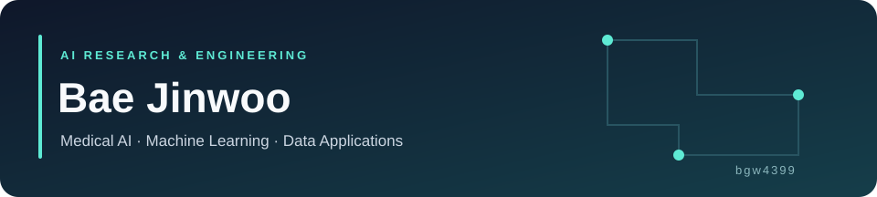

  <a href="https://bgw4399.github.io/">Portfolio</a> ·
  <a href="https://bgw4399.github.io/assets/Bae_Jinwoo_CV.pdf">CV</a> ·
  <a href="https://www.kaggle.com/bgw4399">Kaggle</a> ·
  <a href="mailto:bgw4399@gmail.com">Email</a>

안녕하세요, **배진우**입니다. 의료 데이터와 머신러닝을 다루고, 실험 결과를 사용자가 탐색할 수 있는 애플리케이션으로 연결합니다.
**Medical AI · Machine Unlearning · 데이터 기반 서비스**에 관심을 두고 프로젝트를 진행해왔습니다.

### Selected Projects

| 프로젝트 | 구현 내용 | 주요 기술 |
| :--- | :--- | :--- |
| **[Bento / CDM Explorer](https://github.com/bgw4399/bento_frontend_react)** | 코호트 정의·의료 데이터 탐색·차트 UI. [팀 프로젝트의 AI 파이프라인](https://github.com/bgw4399/capstone-2025/tree/master/ai/auto-cohort)도 함께 볼 수 있습니다. | React, JavaScript / TypeScript, FastAPI, OMOP CDM |
| **[CAFA6 Experiments](https://github.com/bgw4399/kaggle-cafa6)** | 단백질 기능 예측을 위한 데이터 준비·학습·검증·stacking 스크립트 | Python, scikit-learn, XGBoost |
| **[Pathology Image Matching](https://github.com/bgw4399/LightGlue_BMI)** | LightGlue 기반 이미지 정합과 타일 매칭, SAM fine-tuning 실험 | Python, PyTorch, Jupyter |
| **[Smart Planting](https://github.com/bgw4399/smart_planting)** | 센서 데이터를 웹·데스크톱 화면으로 연결하는 팀 프로젝트. PyQt·웹 개발 참여 | Python, PyQt, Arduino, MongoDB |

### Tools I Work With

| 분야 | 기술 |
| :--- | :--- |
| ML & experiments | Python · PyTorch · scikit-learn · XGBoost · Jupyter |
| Data & APIs | pandas · FastAPI · SQLite · OMOP CDM |
| Interfaces | React · JavaScript / TypeScript · HTML / CSS · PyQt |

### Research & Project Notes

Machine Unlearning, CAD 경로 설계, 운영 대시보드, Kaggle 실험에 관한 설명은 **[프로젝트 노트](docs/projects/README.md)**에 모았습니다.
노트에는 공개 범위와 관련 코드 위치를 함께 표시했습니다.

팀 프로젝트의 기여와 사용한 오픈소스는 각 저장소의 설명을 참고해 주세요.
